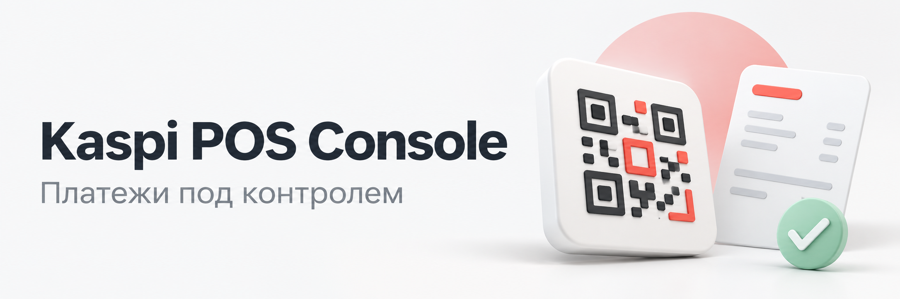
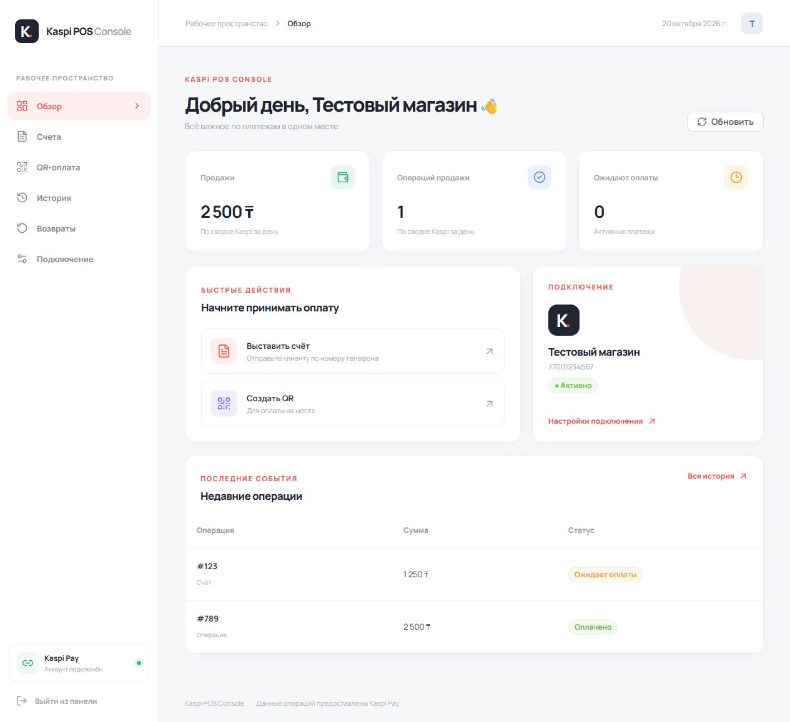

# Kaspi POS Console

**Счета, QR-оплата и история Kaspi Pay — в одном сервисе с удобной веб-панелью.**

Go на сервере, Vue 3 и Element Plus в интерфейсе. Подключайте свои приложения через API, управляйте оплатой в браузере и получайте уведомления Telegram о состоянии подключения.

[Быстрый старт](#быстрый-старт) · [Интерфейс](#интерфейс) · [API](docs/API.md) · [Telegram](#уведомления-telegram) · [Қазақша](README.kk.md)

## Возможности

| | Что умеет сервис |
| --- | --- |
| **Счета** | Поиск клиента по телефону, выставление счёта, проверка статуса и отмена |
| **QR-оплата** | Генерация QR в браузере, таймер ожидания и автоматическое обновление статуса |
| **История и возвраты** | Операции напрямую из Kaspi, подробности, чеки и доступная сумма возврата |
| **Доступ** | Вход в панель по паролю и отдельные именованные Bearer-ключи для ваших сервисов |
| **Telegram** | Фоновая проверка сессии и уведомления о потере связи и восстановлении |
| **Вебхуки** | События платежей с HMAC-подписью и сохранением очереди доставки |
| **Развёртывание** | Один Go-сервис, собранная Vue-панель и Docker Compose |

Неофициальная интеграция с внутренними интерфейсами Kaspi Pay. Их поведение может меняться; проект не является официальным продуктом Kaspi.

## Интерфейс



*Скриншот настоящего интерфейса с демонстрационными данными. Реальные клиентские данные, ключи и платежи не используются.*

## Быстрый старт

### 1. Подготовьте проект

```bash
git clone https://github.com/kantaevsherhan/shrk-kaspi-pos-automation.git
cd shrk-kaspi-pos-automation
```

Скопируйте [.env.example](.env.example) в `.env` и заполните два обязательных параметра:

```dotenv
TOKEN_SECRET_KEY=<случайные 64 hex-символа>
SERVICE_API_KEYS={"orders":"<отдельный случайный ключ длиной от 32 символов>"}
```

Значения в угловых скобках замените своими. `TOKEN_SECRET_KEY` шифрует сессию Kaspi; ключ из `SERVICE_API_KEYS` используется для доступа к API. Для каждого приложения можно добавить отдельную запись с уникальным ключом.

Случайный секрет в PowerShell 7 можно получить командой ниже. Выполните её отдельно для ключа шифрования и для каждого API-ключа:

```powershell
[Convert]::ToHexString([System.Security.Cryptography.RandomNumberGenerator]::GetBytes(32))
```

### 2. Запустите сервис

**Через Docker Compose:**

```bash
docker compose up -d --build
```

Compose собирает сервер и панель, хранит состояние в volume `kaspi_data` и публикует порт только на `127.0.0.1:3000`.

<details>
<summary><strong>Локальный запуск без Docker</strong></summary>

Для сборки нужны Go 1.27+, Node.js 24 и pnpm 11.25.0 — те же инструменты используются в [Dockerfile](Dockerfile).

```bash
npm install --global pnpm@11.25.0
cd web
pnpm install --frozen-lockfile
pnpm build
cd ..
go run ./cmd/kaspi-pos
```

После сборки панели для работы сервера Node.js не нужен. Запускайте Go-сервис из корня проекта, чтобы он нашёл `.env` и `web/dist/`.

</details>

### 3. Подключите Kaspi Pay

1. Откройте [http://127.0.0.1:3000](http://127.0.0.1:3000).
2. При первом входе создайте администратора: укажите сервисный API-ключ, имя пользователя и пароль от 12 символов. Ключ нужен только для первоначальной настройки.
3. В разделе **«Подключение»** начните вход в Kaspi Pay и подтвердите его кодом из SMS.
4. Проверьте сессию кнопкой **«Проверить сессию»**.

Дальше в панель можно входить по имени и паролю. Выход из панели не отключает Kaspi. Фоновые проверки и вебхуки продолжают работать, пока запущен сервер.

Для доступа извне настройте HTTPS-прокси и `COOKIE_SECURE=true`. Все сервисные API-ключи имеют полный доступ к подключённому аккаунту, включая возвраты.

## Интеграция через API

Вашим приложениям достаточно Bearer-ключа. Сессия Kaspi хранится на сервере, поэтому передавать её токены в каждый запрос не требуется.

Пример создания счёта после подключения аккаунта:

```bash
curl -X POST http://127.0.0.1:3000/api/invoice/create \
  -H 'Authorization: Bearer YOUR_SERVICE_KEY' \
  -H 'Content-Type: application/json' \
  -d '{"phoneNumber":"77001234567","amount":1000,"comment":"Заказ 42"}'
```

| Метод и маршрут | Назначение |
| --- | --- |
| `GET /health` | Доступность сервиса, без авторизации |
| `GET /api/auth/session` | Наличие сохранённой сессии Kaspi |
| `GET /api/session/check` | Проверка сессии запросом к Kaspi |
| `POST /api/invoice/create` | Выставление счёта |
| `POST /api/qr/create` | Создание QR-оплаты |
| `POST /api/history/operations` | История операций |
| `POST /api/refund/create` | Возврат средств |

Все маршруты, форматы запросов и ответы — в [документации API](docs/API.md).

Между отправками счетов действует общий интервал `INVOICE_SEND_INTERVAL=3.5s`. Первый счёт отправляется сразу, последующие ждут 3,5 секунды после завершения предыдущего запроса. Интервал общий для панели и всех сервисных ключей; `0s` отключает его. Настройка задаётся в `.env` и применяется после перезапуска. Дополнительных пауз после серии счетов нет.

### Вебхуки

Создайте `STATE_DIR/webhooks.json` по [примеру](webhooks.example.json). Сервис отправляет события `payment.success`, `payment.failed`, `payment.expired` и `payment.lost`.

Запрос подписывается заголовком `X-Webhook-Signature: sha256=<HMAC-SHA256>`. При неудаче доставка повторяется с задержками 5 и 30 секунд, максимум три попытки. Очередь сохраняется при перезапуске. Получатель должен проверять подпись и обрабатывать повторные события идемпотентно.

## Уведомления Telegram

1. Создайте бота через `@BotFather` и отправьте `/start` **своему боту** с аккаунта получателя уведомлений.
2. Получите `message.chat.id` через [Bot API getUpdates](https://core.telegram.org/bots/api#getupdates).
3. Добавьте в `.env` оба параметра:

```dotenv
TELEGRAM_BOT_TOKEN=<токен вашего бота>
TELEGRAM_CHAT_ID=<ID чата>
SESSION_CHECK_INTERVAL=2m
```

После изменения `.env` пересоздайте Docker-контейнер, чтобы он получил новые переменные:

```bash
docker compose up -d --force-recreate
```

При локальном запуске перезапустите Go-процесс. Затем в разделе **«Подключение»** нажмите **«Отправить тест»**.

Монитор работает даже при закрытой панели. Он сообщает о потере сессии и восстановлении подключения; сетевой сбой подтверждается после трёх неудачных проверок подряд. Повторные проверки одного сбоя не создают новые сообщения. До первого подключения Kaspi уведомления об отсутствии сессии не отправляются.

## Конфигурация

| Переменная | По умолчанию | Назначение |
| --- | --- | --- |
| `TOKEN_SECRET_KEY` | Обязательна | Ключ шифрования: 64 hex-символа |
| `SERVICE_API_KEYS` | Обязательна | JSON-объект с именами сервисов и уникальными ключами от 32 символов |
| `HOST` | `127.0.0.1` | Адрес сервера; внутри Docker Compose — `0.0.0.0` |
| `PORT` | `3000` | Порт Go-сервера |
| `STATE_DIR` | `data` | Каталог состояния; в контейнере — `/data` |
| `COOKIE_SECURE` | `false` | Установите `true` при доступе к панели через HTTPS |
| `TELEGRAM_BOT_TOKEN` | Не задана | Токен бота; используется вместе с ID чата |
| `TELEGRAM_CHAT_ID` | Не задана | Чат для уведомлений |
| `SESSION_CHECK_INTERVAL` | `2m` | Интервал проверки сессии, от `30s` до `1h` |
| `WEBHOOKS_FILE` | `STATE_DIR/webhooks.json` | Путь к конфигурации вебхуков |

Параметры профиля приложения и устройства, включая `APP_VERSION` и `APP_BUILD`, перечислены в [.env.example](.env.example).

## Хранение данных

Завершённая история операций запрашивается из Kaspi. SQLite и локальный журнал завершённых платежей не используются.

В `STATE_DIR` сохраняются только данные, необходимые для работы сервиса:

- идентификатор устройства и ключ ECDSA;
- зашифрованная сессия Kaspi;
- хеш пароля администратора;
- незавершённые платежи и очередь доставки вебхуков;
- текущее состояние мониторинга и отправленных уведомлений.

Для резервного копирования сохраняйте `STATE_DIR` вместе с `.env`, особенно `TOKEN_SECRET_KEY`. В Docker данные находятся в volume `kaspi_data`. Не добавляйте эти данные в Git.

При переходе со старой Node-версии войдите в Kaspi заново по SMS. Прежние JSON-файлы незавершённых платежей и повторов вебхуков поддерживаются при миграции.

## Разработка и проверка

Исходники сервера находятся в `internal/app/`, точка входа — `cmd/kaspi-pos/main.go`. Панель находится в `web/src/`, результат сборки — в `web/dist/`.

Запустите сервер из корня проекта:

```bash
go run ./cmd/kaspi-pos
```

В другом терминале запустите Vite:

```bash
cd web
pnpm install --frozen-lockfile
pnpm dev
```

Vite перенаправляет `/api` и `/health` на Go-сервер `127.0.0.1:3000`.

Проверки перед коммитом:

```bash
go test ./cmd/... ./internal/...
go vet ./cmd/... ./internal/...
cd web
pnpm build
```

Локально проверены API-контракты исходной Node-версии, криптография, сохранение состояния, авторизация, мониторинг, вебхуки, интерфейс и запуск Docker. Реальные SMS, платежи и возвраты с аккаунтом Kaspi в рамках этой проверки не выполнялись. Сценарии и изолированный стенд для браузера описаны в [отчёте проверки](docs/VERIFICATION.md).

## Если что-то не работает

| Ситуация | Что проверить |
| --- | --- |
| Сервис не запускается | Заполнены ли оба обязательных секрета и корректен ли JSON в `SERVICE_API_KEYS` |
| API отвечает `401` | Передан ли `Authorization: Bearer <ключ>`; для платёжного запроса также нужна сессия Kaspi |
| Kaspi возвращает `OldVersionToUpdate` | Обновите `APP_VERSION`, `APP_BUILD` и профиль устройства в `.env` под используемую версию Kaspi Pay, затем перезапустите сервис |
| Telegram не настроен | Укажите токен и ID вместе, отправьте `/start` своему боту и проверьте тестовое уведомление |
| Изменения `.env` не применились в Docker | Выполните `docker compose up -d --force-recreate`; обычный `restart` не меняет окружение контейнера |

---

[API](docs/API.md) · [Участие в разработке](CONTRIBUTING.md) · [Безопасность](SECURITY.md) · [Лицензия MIT](LICENSE)
